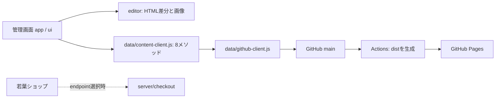

# エンジニア引き継ぎ — KUNI OFFICE

## 最初に読む順番

1. この資料で、動いている部分とこれから実装する部分を確認する。
2. [管理画面APIの契約](ADMIN_API.md)で、画面と保存先の境界を確認する。
3. `npm ci --ignore-scripts` → `npm test` → `npm run build:static` を実行する。
4. `npm run preview` → `http://localhost:8000/admin/` で画面を確認する。

現在も、管理画面の保存先は **GitHub の `playmark0227-svg/kunioffice`、`main`**。
ローカルの管理画面でも、実際のキーで「公開する」と本番にコミットする。
実装・検証ではコピーしたテストリポジトリと別のキーを使い、`admin/js/config.js` の対象を切り替える。
アクセスキーをURL、資料、ソース、スクリーンショット、テスト、ログへ入れない。

## ディレクトリと担当

```text
index.html / services.html / works.html / company.html / contact.html
css/・js/・images/          公開サイト。URLを維持するためルートに置く
wakaba/                    若葉ショップ（現在の注文方法はメール）
admin/
  index.html               管理画面のHTML、JSの読込順、CSP
  setup.html               現在のGitHubアクセスキーの用意
  js/config.js             編集対象、リポジトリ、共通情報、実績ひな形
  js/app/                  起動・認証・状態管理・公開の進行
  js/data/                 保存先との通信と変更対象パスの制限
  js/editor/               HTML解析、プレビュー編集、画像変換
  js/ui/                   表示部品、通知、ダイアログ
server/checkout/           既存のStripe Checkoutサーバー（任意）
server.js                  既存の起動方法を保つ入口
manual/                    サイト担当者向けの操作マニュアル
docs/                      開発者向けの引き継ぎ資料
tests/                     認証情報・実決済を使わない自動テスト
scripts/build-static.mjs   公開用ファイルだけをdist/へ取り出す
dist/                      生成物。編集・コミットしない
```

`npm start` はショップの決済サーバーの起動。**管理画面APIの起動ではない**。
サーバー側の詳細は [server/README.md](../server/README.md)。

## 現在の処理の流れ



- `app/admin.js` が全体を管理する。`app.content` が編集画面から使う通信窓口。
- `data/content-client.js` が、保存先の8メソッドだけを画面へ公開する。
- `data/github-client.js` は現在のアダプター。認証確認、Git保存、履歴、取り消し、Actions確認を担当。
- `editor/` はGitHubを直接呼ばない。元HTMLへの差分適用と、`data-cms-lock` 等の編集制限を維持する。
- `data/path-policy.js` は、管理画面・サーバー・開発資料等を、保存・共通情報の置換・取り消しの対象から外す。
- 公開先に出すものは `scripts/build-static.mjs` の許可リストで管理する。新しい公開ページを追加したらリストも更新する。

## サーバー実装で担当してもらう部分

今回、以下は実装していない。言語・フレームワーク・ホスティング・DBは未選定。
既存の編集画面を保ち、まずは「サーバー経由で現在のGitHub保存を行う」段階から移行できる。

| 作業 | 実装先・接続点 | 完了条件 |
|---|---|---|
| 管理者の認証・セッション | 新設する管理API（配置案 `server/admin/`）と `admin/js/app/admin.js` のログイン・起動・ログアウト | 利用者がGitHubキーを入力せず、期限切れ・失効・ログアウトも扱える |
| 保存先アダプター | 新設する `admin/js/data/api-client.js`。ログイン成功時の `ContentClient.from(...)` を差し替える | [8メソッド](ADMIN_API.md)の型・エラー・競合検出を保つ |
| サーバー側の認可 | API全体で対象リポジトリ・ブランチ・編集可能パスを固定して検証 | リクエストのowner/repo/pathをそのまま信用せず、画面外のファイルを書き換えられない |
| 公開・履歴・取り消し | API → GitHub、公開ジョブの状態管理 | 保存成功と公開反映成功を区別し、競合・失敗・再試行を表示できる |
| 公開環境・運用 | ステージング、本番API、秘密の管理、監査、監視、バックアップ | 秘密をブラウザへ返さず、エラーやログにも残さない |
| 移行 | 認証切替、旧キーの扱い、CSP、テスト端末 | ステージングで一通り確認後に本番へ切り替える |

### 認証・通信を切り替えるとき

- サーバー認証へ移る際は、`app/admin.js` の `readToken/saveToken/clearToken`、`login/boot/logout` も置き換える。
  `api-client.js` を追加するだけでは、利用者のキー入力は不要にならない。
- サーバーのGitHub用の認証情報は、デプロイ先の秘密管理機能で管理する。現在のブラウザ用キーを資料へ転記しない。
- ブラウザは管理APIのセッションCookieを使う構成を検討する。HttpOnly / Secure / SameSite、CSRF対策、期限・失効、認可を実装する。
  別オリジンならcredentials付きCORSと許可元を明示する。Cookieの制約を避けるため、管理画面とAPIを同一オリジンに置く構成を優先して検討する。
- `admin/index.html` のCSPは現在 `connect-src https://api.github.com` のみ。API配置先に合わせて変更する。
- 現在の `verify()` は書き込み可能かを小さなGit blobの作成で調べる。
  `checkScope()` は他のリポジトリも書けるキーでないかを調べる。サーバーのセッション確認には流用しない。
- 移行完了時は、旧キーのブラウザ保存を整理し、不要なキーの失効手順をサイト管理者と決める。

## データ・決済の現状

- CMSの正本はページHTMLと画像。DB・会員情報・CMSユーザー管理はない。
- DBやオブジェクトストレージへ移す場合は、別途スキーマ・HTMLとの移行方法・履歴・復元方式を決める。
- 若葉ショップは `wakaba/js/config.js` の `checkout.mode = 'email'`。今回変更していない。
- 既存Checkoutサーバーは `/api/checkout` と `/webhook` を持つ。
  Webhookはイベントをログに出す段階で、注文DB・発送処理・通知・重複イベント処理は未実装。
- `thanks.html?status=paid` の表示は決済証明ではない。決済確認は署名検証したWebhookとサーバー側の記録で行う。
- 現行の価格・送料・数量処理を整理のみで維持した。実運用前に、整数の厳密検証・商品IDの重複時の数量上限等も確認する。

## 検証とリリース

```bash
npm ci --ignore-scripts
npm test
npm run build:static
npm run preview
```

CIはPRでテストと静的成果物の生成を実施する。`main` 更新時はPages用ワークフローが `dist/` のみ公開する。
GitHub PagesではNodeサーバーは動作しない。管理API・決済APIは別の実行環境へデプロイする。
ステージングで認証、文章・写真・実績、競合、公開完了、履歴取り消し、モバイル表示を確認してから本番へ反映する。

ブラウザの記憶機能は、このセッションではMacのSafariで再読み込み・新規タブの自動接続を確認済み。
Chromeでは記憶が維持されず、原因は未確定。サーバー認証導入時にブラウザ別のセッション継続も検証する。

現在のキー用意ページは期限を366日で指定する。今回のアカウントではGitHubに上限365日と表示されたため、
作成時は365日に変更した。次回の発行前に `admin/js/app/setup.js` と `admin/setup.html` の初期値も確認する。
